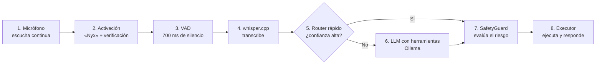

# Nyx — Especificación del asistente de voz

> Fuente de verdad del proyecto. Versión del documento: 2026-11-09. Original: https://claude.ai/artifact/2shgSn5n6TiXHhyBStHnXz

## 1. Visión y principios

Nyx es un asistente de voz y texto para Windows 11 que ejecuta acciones en el PC y responde preguntas, funcionando en local, gratis y sin una ventana propia. Este documento es la especificación de referencia para desarrollarlo con Claude en VS Code.

**Objetivo:** decir "Nyx, abre Valorant" y que se abra sin decir nada; decir "Nyx, ¿cómo se dice hola en alemán?" y que responda por voz y muestre la palabra en una burbuja.

**Principios (en orden de prioridad):**

1. **Silencioso por defecto.** Las acciones en el PC se ejecutan sin hablar ni mostrar interfaz, salvo un gesto mínimo de confirmación visual opcional.
2. **Rápido.** Objetivo: menos de 500 ms para comandos frecuentes y menos de 2 s para peticiones que pasan por el modelo de lenguaje.
3. **Local y gratis.** Todo el núcleo (activación, voz, cerebro, acciones) funciona sin internet y sin coste. Internet solo para lo que lo requiere (tiempo, webs, búsquedas).
4. **Seguro.** Nada destructivo sin confirmación; borrar siempre va a la papelera.
5. **Respetuoso con el juego.** Nunca interfiere en una partida si el usuario no lo permite, y **nunca actúa dentro de un juego** (ni teclas, ni chat, ni macros, ni leer la pantalla): solo abrirlo, la música, el volumen y responder preguntas.
6. **Interfaz mínima.** Sin ventana fija: elementos flotantes, redondeados y translúcidos que aparecen solo cuando aportan algo.
7. **Extensible.** Añadir una acción nueva es añadir una herramienta (o una entrada en el catálogo de acciones por app), no reescribir el sistema. El catálogo completo de lo que Nyx hace y hará está en [ACCIONES.md](ACCIONES.md).

**Fuera de alcance (v1):** macOS/Linux, automatizar acciones dentro de juegos, control remoto desde el móvil, varios usuarios.

## 2. Stack tecnológico

Nyx se divide en dos procesos: un núcleo en Python que escucha, piensa y actúa, y una interfaz en Tauri 2 que solo dibuja. Hablan por WebSocket local. Todo es gratuito y funciona en el PC de referencia: Windows 11, AMD Radeon RX 7700 XT (12 GB VRAM), Ryzen 7, 32 GB RAM.

| Pieza | Elección | Alternativa | Notas |
| --- | --- | --- | --- |
| Núcleo | Python 3.12, asyncio | — | Ecosistema de voz e IA más maduro |
| Interfaz | Tauri 2 + Svelte 5 + TypeScript + Canvas/WebGL | PySide6 + QML | Animaciones y cristal con tecnología web; WebView2 viene con Windows 11. Tauri es el proceso principal y lanza el núcleo |
| Entorno Python | uv | — | Instala Python 3.12 y gestiona dependencias |
| Efecto cristal | `window-vibrancy` (Acrylic/Mica) | CSS `backdrop-filter` | Translucidez nativa de Windows 11 |
| Activación | openWakeWord (ONNX) | Vosk con gramática | Modelo propio para "Nyx"; Vosk para palabras personalizadas |
| Detección de voz (VAD) | Silero VAD (ONNX) | WebRTC VAD | Corta la grabación al dejar de hablar |
| Voz a texto | whisper.cpp con backend Vulkan | whisper.cpp en CPU | faster-whisper no acelera en AMD; usar large-v3-turbo cuantizado |
| Cerebro | Ollama (ROCm o Vulkan) | LM Studio | Modelo instruct de 7–8B con tool calling; 14B cuantizado como opción |
| Texto a voz | Pocket TTS (Kyutai; código MIT, pesos CC BY 4.0), voz «lola» | Piper (GPL-3.0): davefx y daniela | En la CPU con 2 hilos; genera a trozos (primer audio en ~0,08 s). Necesita PyTorch para CPU |
| Acciones Windows | pywin32, comtypes, pycaw, psutil, winsdk | PowerShell | Ventanas, audio, procesos, notificaciones |
| Papelera | send2trash | — | Nunca borrado permanente |
| Capturas | mss | Windows Graphics Capture | Por monitor |
| Grabación | FFmpeg (`ddagrab` + códec AMF de AMD) | OBS por WebSocket | Hardware de la GPU, casi sin impacto |
| Búsqueda de archivos | Everything (es.exe / SDK) | Índice propio | Gratis e instantáneo en todo el disco |
| Caché | SQLite + rapidfuzz + watchdog | — | Índice de apps, carpetas y alias; la búsqueda difusa en memoria (< 5 ms con miles de alias) sustituye a FTS5 |
| Tiempo | Open-Meteo | — | Gratis, sin clave |
| Empaquetado | Nuitka o PyInstaller + Velopack (instalación y actualizaciones desde GitHub) | — | Un solo instalador |

**Requisitos de diseño del stack:**

- Todos los modelos se descargan en el primer arranque a `%LOCALAPPDATA%\Nyx\models`, con barra de progreso y verificación de hash.
- Cada pieza de IA va detrás de una interfaz (`WakeWordEngine`, `STTEngine`, `LLMEngine`, `TTSEngine`) para poder cambiarla sin tocar el resto.
- Detectar al arrancar si la GPU está disponible para Ollama y whisper.cpp; si no, caer a CPU y avisar una vez.
- Verificar las licencias de cada modelo y librería antes de distribuir.

## 3. Arquitectura y flujo de una petición

Una petición recorre siempre el mismo camino: oír, transcribir, decidir, actuar y responder. Los comandos frecuentes se saltan el modelo de lenguaje para ser instantáneos.



Lo frecuente va directo de la transcripción a la ejecución; solo lo nuevo o complejo pasa por el LLM.

**Servicios del núcleo** (cada uno un módulo, comunicados por un bus de eventos asyncio):

- `AudioService`: micrófono a 16 kHz mono, búfer circular con 2 s de pre-grabación.
- `WakeService`: palabra de activación y verificación.
- `STTService`: transcripción.
- `Brain`: router rápido + LLM con herramientas.
- `ToolRegistry` y `Executor`: catálogo de acciones y su ejecución.
- `SafetyGuard`: niveles de riesgo y confirmaciones.
- `GameModeService`: detección de partida y políticas.
- `SystemIndex`: caché del sistema.
- `TTSService`: síntesis de voz.
- `UIBridge`: WebSocket con la interfaz.
- `Settings` y `Logger`.

**Flujo paso a paso:**

1. El micrófono escucha en continuo; solo el detector de activación procesa el audio (bajo consumo).
2. Al detectar "Nyx", la verificación confirma la palabra. La interfaz pasa a "escuchando".
3. Se admite la frase de una tirada ("Nyx abre Valorant"): el audio posterior a la palabra en el mismo búfer forma parte del comando.
4. El VAD cierra la grabación tras 700 ms de silencio (máximo 15 s). En cada pausa de ~0,4 s se transcribe lo dicho: si ya es una petición completa (una pregunta o una orden que el router entiende), se deja de escuchar ahí y lo que el usuario siga diciendo (a otra persona) no cuenta.
5. whisper.cpp transcribe. La interfaz pasa a "pensando" solo si tarda más de 300 ms.
6. El router rápido compara con reglas y alias de la caché. Con confianza alta, ejecuta sin LLM.
7. Si no, el LLM recibe el texto, el contexto (fecha, app activa, monitor, modo partida, últimos turnos) y las herramientas, y devuelve una o varias llamadas.
8. `SafetyGuard` evalúa cada llamada; si hace falta, pide confirmación.
9. `Executor` ejecuta y devuelve un resultado estructurado.
10. Respuesta según el tipo de petición (tabla siguiente).
11. Ventana de seguimiento de 5 s: se puede seguir hablando sin repetir "Nyx" (configurable). Solo cuenta una frase que empiece tras un silencio (no una conversación que ya estaba en marcha); las coletillas («vale», «sí, claro») se ignoran, y lo que no es una orden clara pasa por un clasificador corto del LLM («¿va dirigido a Nyx?»): si no, Nyx no responde.

| Tipo de petición | Voz | Burbuja | Ejemplo |
| --- | --- | --- | --- |
| Acción en el PC que sale bien | No | No (destello opcional del indicador) | "Abre Visual Studio Code" |
| Pregunta o información | Sí | Sí, con el dato clave destacado | "¿Cómo se dice hola en alemán?" |
| Acción con resultado útil | Breve | Sí | "Pon una alarma a las 10:50" → "Alarma a las 10:50" |
| Confirmación necesaria | Breve | Sí, con botones | "Elimina la carpeta Fondos" |
| Error o no entendido | Breve | Sí | "No encuentro esa aplicación" |

**Reglas transversales:**

- **Interrupción:** decir "Nyx" mientras habla corta la voz y escucha de nuevo.
- **Entrada por texto:** un atajo de teclado (por defecto `Win+Alt+N`) abre una burbuja con campo de texto; mismo flujo desde el paso 6, pero por defecto la respuesta va solo en la burbuja (sin voz): quien escribe suele querer silencio. Configurable en Ajustes → Respuestas ("Responder también en voz a lo escrito").
- **Una sola petición a la vez:** las nuevas cancelan las pendientes que no hayan empezado a ejecutarse.

## 4. Palabra de activación

"Nyx" a secas es la palabra principal y debe funcionar de forma fiable aunque sea monosílaba. Las palabras personalizadas exigen 2 sílabas o más (recomendado "Oye ___").

**"Nyx" (modelo propio con openWakeWord):**

1. **Entrenamiento:** miles de muestras sintéticas de "Nyx" con voces TTS variadas (pronunciación española /niks/ e inglesa), velocidades, tonos, ruido de fondo y reverberación.
2. **Negativos difíciles:** nix, mix, six, fix, ni, nis, Nike, next, "ni se", "y ya", además de horas de habla genérica en español, música, audio de juegos y streams.
3. **Muestras del usuario:** en la configuración inicial, el usuario graba "Nyx" de 20 a 30 veces (cerca, lejos, susurrando, normal). Se usan para ajustar el modelo o un clasificador ligero encima.
4. **Segunda verificación** (activa desde la fase 2, también con Vosk): al saltar el detector, whisper.cpp transcribe los últimos 2 s mientras el usuario sigue hablando y solo continúa si aparece "nyx", "nix", "nics"… Si no, deja de escuchar sin decir nada. Si la verificación llega tarde, vale con que la frase completa empiece por "Nyx". Coste aproximado: 80–150 ms en GPU.
5. **Contexto de la frase:** solo cuenta si va tras 300 ms de silencio o al principio de la frase. Si está en mitad de una conversación, se ignora.
6. **Verificación de voz (opcional):** embedding de hablante (por ejemplo, un modelo ECAPA en ONNX) para reaccionar solo a la voz del usuario. Útil con Discord o el stream abiertos.
7. **Calibración:** sensibilidad de 1 a 10 en ajustes. Registro local de activaciones con botón "esto fue un error" para ajustar el umbral automáticamente.

**Palabras personalizadas (Vosk):**

- Modelo pequeño en español (unos 40 MB) con gramática restringida a la frase elegida + `[unk]`.
- Cambio instantáneo desde ajustes, sin entrenar.
- Validación al guardarla: mínimo 2 sílabas; aviso si se parece a palabras comunes. Botón "probar" que mide aciertos en 5 intentos.
- Opción avanzada: "entrenar modelo dedicado" en segundo plano con el mismo proceso que "Nyx", para máxima precisión.

**Alternativas siempre disponibles:**

- Atajo de teclado para hablar (por defecto `Win+Alt+H`): un toque escucha hasta que te callas; mantenerlo escucha mientras lo mantienes. Configurable.
- Atajo para escribir (ver sección 3).
- Silenciar el micrófono de Nyx con un atajo; el indicador lo muestra.

**Objetivos de calidad:** menos de 1 falsa activación cada 8 horas de audio normal y más del 95 % de aciertos a 1–2 m del micrófono.

## 5. Voz: reconocimiento y síntesis

whisper.cpp transcribe en la GPU con Vulkan y la voz (Pocket TTS o Piper) se genera en la CPU, para no competir con el modelo de lenguaje ni con los juegos.

**Reconocimiento (STT):**

- Modelo principal: Whisper large-v3-turbo cuantizado (q5) en whisper.cpp con Vulkan. Alternativa en CPU: `small` o `medium`.
- Idioma fijado en español, con detección automática solo si el usuario la activa (para frases en inglés como nombres de juegos).
- **Prompt inicial** con vocabulario propio: nombres de apps y juegos de la caché, carpetas del usuario y "Nyx". Mejora mucho nombres como "Valorant" o "Visual Studio Code".
- Proceso residente con el modelo cargado; nunca cargarlo por petición.
- Supresión de ruido ligera (RNNoise) opcional antes del VAD.
- Normalizar el texto: números ("diez cincuenta" → 10:50), mayúsculas y eliminar "Nyx" del inicio.

**Síntesis (TTS):**

- Voz predeterminada «lola» (mujer) con Pocket TTS de Kyutai: la voz femenina libre en español que mejor suena en la CPU. Genera a trozos, así que la primera palabra suena ~0,1 s después de tener la frase. Alternativas en Ajustes (Piper): davefx (hombre, España, CC0) y daniela (mujer, Argentina, CC BY-SA 4.0). Pruebas de escucha del 2026-11-09 en `docs/benchmarks/tts-TomPi-20261109.jsonl`: Kokoro y Piper sharvard F (mujer, España) sonaban robóticas; Chatterbox Multilingual (MIT) es más natural pero en la CPU tarda ~10 s por frase; la clonación de voz de Pocket TTS exige cuenta de Hugging Face y consentimiento de la persona, así que no se usa. Créditos obligatorios: Kyutai (CC BY 4.0) y los corpus de las voces CC BY. Pendiente para la auditoría de la fase 6: licencia concreta de la voz «lola» (kyutai/tts-voices).
- **Streaming por frases:** empezar a hablar en cuanto el LLM genera la primera frase, sin esperar la respuesta completa.
- Texto adaptado para voz: el LLM genera `spoken` (corto y natural, primero para que la voz empiece antes), `display` (dato destacado de la burbuja) y `secondary` (línea pequeña). Ejemplo: voz "En alemán se dice Hallo", burbuja "Hallo" grande + "hola · alemán" pequeño.
- Palabras en otros idiomas pronunciadas con la voz de ese idioma cuando exista (Piper tiene voces en muchos idiomas).
- Audio por el dispositivo de salida elegido en ajustes (útil para separar del juego o del stream).
- Atenuar el volumen de otras apps (ducking) mientras habla; desactivado por defecto en modo partida.
- Velocidad, tono y voz configurables.

## 6. Cerebro: router rápido y LLM

El cerebro decide qué herramientas ejecutar en dos niveles: un router determinista para lo frecuente y un LLM local para todo lo demás.

**Nivel 1: router rápido (sin LLM, menos de 50 ms):**

- Patrones en español con variantes: "abre/abrir/lanza/inicia X", "cierra X", "sube/baja el volumen", "silencia", "captura de pantalla", "para la grabación"…
- X se resuelve contra los alias de la caché con coincidencia difusa (rapidfuzz). Si la puntuación es mayor de 90 y no hay empate, se ejecuta directamente.
- Si hay duda, pasa al nivel 2 con los candidatos como pista.
- El router aprende: cuando el LLM resuelve una frase a una única acción simple con éxito, se guarda como atajo (con opción de revisarlos en ajustes).

**Nivel 2: LLM con herramientas:**

- Ollama con modelo instruct de 7–8B que soporte tool calling (evaluar Qwen y Llama de esa talla con la batería de pruebas de la sección 14). 14B cuantizado como opción en ajustes.
- Modelo siempre cargado (`keep_alive` largo) y contexto corto (8k tokens; las herramientas ocupan ~3,4k) para responder rápido. El prefijo fijo (sistema + herramientas) se precalienta y no cambia entre peticiones: la hora y la ventana activa van con el mensaje del usuario.
- **Prompt de sistema** con: identidad y tono de Nyx (breve, español, sin relleno), fecha y hora, app en primer plano, monitor activo, estado de modo partida, carpetas conocidas y reglas de seguridad.
- **Herramientas expuestas de forma dinámica:** solo las relevantes según categoría detectada (máximo unas 15 por llamada) para no saturar un modelo pequeño.
- **Salida estructurada:** el LLM recibe las herramientas en cada llamada. Para una acción devuelve llamadas a herramientas; para una pregunta responde en texto que se lee a trozos: primera línea `[dato | contexto]` (la burbuja) y después lo que se dice en voz alta, para empezar a hablar con la primera frase (probado en la fase 3: Ollama no permite combinar el JSON con esquema y las herramientas). Sustituye a la herramienta `answer`. Las llamadas a herramientas se validan con pydantic y, si fallan, se reintenta una vez con el error (fase 3).
- **Planes de varios pasos:** "Abre el bloc de notas y abre una nueva pestaña" = `open_app(notepad)` → `wait_for_window` → `send_hotkey(ctrl+n)`. El ejecutor hace las esperas, no el LLM.
- **Memoria corta:** últimos 6 turnos para entender "y ahora ciérralo" o "muévelos también".
- **Preferencias aprendidas:** si el usuario corrige ("no, el Chrome, no Edge"), se guarda como preferencia local.

**Nivel 3 (opcional, desactivado por defecto): nube gratuita.** Para preguntas complejas de conocimiento general, opción de usar una API con plan gratuito. El usuario la activa y pone su clave; nunca se envían datos del sistema, solo la pregunta.

**Preguntas de actualidad:** búsqueda web (por ejemplo, DuckDuckGo sin clave) + resumen del LLM, indicando la fuente en la burbuja.

## 7. Catálogo de herramientas

Unas 35 herramientas genéricas cubren miles de peticiones al combinarse. Cada una tiene nombre, descripción en español para el LLM, esquema de parámetros, nivel de riesgo (sección 8) y política en partida (sección 9).

| Herramienta | Qué hace | Riesgo | Implementación |
| --- | --- | --- | --- |
| `open_app` | Abre una app o juego de la caché y le da el foco (salvo «en segundo plano») | Verde | Acceso directo, AppUserModelID o lanzador (Steam, Riot, Epic) |
| `close_app` | Cierra una app | Amarillo (rojo si hay cambios sin guardar) | WM_CLOSE; nunca matar el proceso salvo confirmación |
| `focus_window` | Trae una ventana al frente | Verde | pywin32 |
| `window_layout` | Maximizar, minimizar, mover a otro monitor, dividir pantalla | Verde | pywin32 + atajos de Windows |
| `open_url` | Abre una web en el navegador por defecto | Verde | `os.startfile`; diccionario de sitios (YouTube, Claude…) |
| `web_search` | Busca en internet y abre o resume | Verde | Navegador o búsqueda + LLM |
| `create_folder` | Crea una carpeta | Verde | pathlib |
| `list_files` | Lista con filtros (últimos N, tipo, fecha, tamaño) | Verde | pathlib + Everything |
| `find_files` | Busca archivos en todo el disco | Verde | Everything |
| `move_files` / `copy_files` | Mueve o copia | Amarillo | shutil; deshacer disponible 30 s |
| `rename_file` | Renombra | Amarillo | pathlib; deshacer |
| `delete_files` | Elimina a la papelera | Rojo | send2trash |
| `open_path` | Abre carpeta o archivo | Verde | Explorador |
| `open_settings` | Abre una página de Configuración | Verde | URIs `ms-settings:` (ratón: `ms-settings:mousetouchpad`) |
| `set_volume` | Volumen general o por app, silenciar | Verde | pycaw |
| `set_brightness` | Brillo | Verde | screen-brightness-control |
| `toggle_wifi` / `toggle_bluetooth` | Conectividad | Amarillo | WinRT Radios |
| `media_control` | Reproducir, pausar, siguiente | Verde | Teclas multimedia / SMTC |
| `screenshot` | Captura de un monitor, ventana o región | Verde | mss; guarda en Imágenes\Capturas y copia al portapapeles |
| `screen_record` | Iniciar o parar grabación | Verde | FFmpeg `ddagrab` + AMF; indicador discreto mientras graba |
| `set_alarm` | Alarma a una hora | Verde | Planificador propio persistente + notificación y sonido |
| `set_timer` | Temporizador | Verde | Igual que alarma |
| `set_reminder` | Recordatorio con texto | Verde | Dentro de `set_alarm` y `set_timer` (campo `label`) |
| `get_weather` | Tiempo actual y previsión | Verde | Open-Meteo; ubicación fijada en ajustes |
| `get_time_date` | Hora, fecha, cálculos de fechas | Verde | Local |
| `answer` | Respuesta de conocimiento, traducción, cálculo | Verde | LLM |
| `clipboard` | Leer, escribir o resumir el portapapeles | Verde | pywin32 |
| `type_text` | Escribe texto en la app activa | Amarillo | SendInput |
| `send_hotkey` | Envía un atajo de teclado | Amarillo | SendInput; lista de atajos peligrosos bloqueada |
| `wait_for_window` | Espera a que aparezca una ventana | Verde | Interno del ejecutor |
| `system_power` | Bloquear, suspender, reiniciar, apagar | Rojo (bloquear: verde) | APIs de Windows |
| `system_info` | Batería, CPU, RAM, GPU, espacio en disco | Verde | psutil |
| `nyx_control` | Cambiar ajustes de Nyx por voz ("modo silencio", "habla más despacio") | Verde | Settings |
| `run_powershell` | Comodín para lo que no cubre nada más | Rojo siempre | Muestra el comando antes; lista de bloqueo |

**Cómo se resuelven los ejemplos del usuario:**

| Petición | Herramientas |
| --- | --- |
| Crea una carpeta en Documentos llamada Fondos | `create_folder(Documentos\Fondos)` |
| ¿Qué temperatura hace hoy? | `get_weather` → voz + burbuja |
| Pon una alarma para las 10:50 | `set_alarm(10:50)` (hoy, o mañana si ya pasó) |
| Abre Claude en el navegador | `open_url(claude.ai)` |
| Abre Visual Studio Code | `open_app(vscode)` (router rápido) |
| Abre el bloc de notas y abre una nueva pestaña | `open_app(notepad)` → `wait_for_window` → `send_hotkey(ctrl+n)` |
| Abre YouTube | `open_url(youtube.com)` |
| Haz una captura del monitor principal | `screenshot(monitor=primary)` |
| Empieza a grabar pantalla | `screen_record(start)` |
| Mueve los últimos 5 archivos de Descargas a Documentos | `list_files(Descargas, newest=5)` → `move_files(…, Documentos)` + deshacer |
| Abre la configuración del ratón | `open_settings(mousetouchpad)` |
| Abre Valorant | `open_app(valorant)` vía Riot Client `--launch-product=valorant --launch-patchline=live` |

**Buenas prácticas al añadir herramientas:** descripciones cortas con ejemplos de frases, parámetros con tipos estrictos, resultados en JSON con `ok`, `message` y `undo` cuando aplique, y una prueba por herramienta.

## 8. Seguridad y confirmaciones

Nada destructivo se ejecuta sin confirmación, y lo que se borra va siempre a la papelera. El riesgo lo decide `SafetyGuard` con reglas fijas, nunca el LLM.

| Nivel | Comportamiento | Ejemplos |
| --- | --- | --- |
| Verde | Se ejecuta sin preguntar | Abrir, crear, consultar, capturar |
| Amarillo | Se ejecuta y muestra "Deshacer" durante 30 s (también por voz: "Nyx, deshaz") | Mover, renombrar, escribir texto, cerrar app sin cambios |
| Rojo | Pide confirmación antes de ejecutar | Eliminar, apagar o reiniciar, cerrar con cambios sin guardar, PowerShell |

**Confirmación:**

- Burbuja con resumen claro de lo que pasará ("Mover 12 archivos de Fondos a la papelera") y botones Confirmar / Cancelar.
- Por voz: "sí", "confirma", "adelante" / "no", "cancela". Vosk con gramática cerrada para que sea fiable.
- Caduca a los 15 s sin respuesta → se cancela.
- Para operaciones de más de 50 archivos o fuera de las carpetas del usuario, la confirmación es solo con clic (no por voz).

**Reglas fijas:**

- **Rutas protegidas:** `C:\Windows`, `Program Files`, `ProgramData`, raíces de disco y la carpeta de Nyx no se modifican nunca.
- **Lista de bloqueo** en `run_powershell` y `send_hotkey`: formateo, cambios de registro, políticas de ejecución, borrado recursivo, desinstalaciones, `Alt+F4` sobre el escritorio, etc.
- **Sin escalado de privilegios:** Nyx se ejecuta como usuario normal. Lo que necesite administrador se rechaza con explicación.
- **Registro de acciones:** cada acción guarda fecha, frase, herramientas, parámetros y resultado (local, rotación a 30 días), consultable desde ajustes.
- **Contenido externo no da órdenes:** el texto de webs, archivos o el portapapeles nunca se interpreta como instrucciones (protección ante inyección de prompts).
- **Privacidad:** el audio no se guarda salvo las muestras de calibración que el usuario grabe; nada sale del PC salvo las peticiones que lo requieren (tiempo, webs y nube opcional) y los datos de uso anónimos si el usuario los activa.

### Sin cuenta

Nyx funciona entero sin registrarse ni iniciar sesión. Para llevar la configuración a otro PC: exportar e importar ajustes, alias y atajos aprendidos en un archivo, u opción de guardarlos en una carpeta sincronizada (por ejemplo OneDrive). Si en el futuro alguna función necesitara servidor, la cuenta sería opcional y solo para esa función; nada local dependería de ella.

### Datos de uso anónimos (solo con permiso)

Desactivados por defecto. El asistente de primer arranque pregunta "¿Ayudar a mejorar Nyx?" con la casilla sin marcar y un enlace a "ver exactamente qué se envía". Se puede cambiar en Ajustes → Privacidad.

| Se envía (si el usuario lo activa) | Nunca se envía |
| --- | --- |
| Versión de Nyx y de Windows | Audio, transcripciones o frases |
| GPU, VRAM y RAM (por tramos), backend (Vulkan, ROCm, CPU) y modelo de LLM | Nombres o rutas de archivos y carpetas |
| Latencias: activación → acción, transcripción, primera palabra del LLM | Nombres de apps, ventanas o webs, y parámetros de las herramientas |
| Uso de cada herramienta (solo el nombre) y aciertos del router rápido frente al LLM | Portapapeles, capturas o grabaciones |
| Número de falsas activaciones marcadas como error | Ubicación (la ciudad del tiempo) |
| Errores por tipo y firma de los cierres inesperados | Identificadores fijos o la IP (el servidor no la guarda) |

- Envío agrupado una vez al día, con un identificador aleatorio que cambia cada mes como máximo.
- Botón opcional "enviar esta frase" cuando Nyx no entiende algo: muestra el texto exacto antes de enviarlo y alimenta la batería de pruebas.
- El servicio se elige en la fase 6 (por ejemplo Aptabase, pensado para apps de escritorio y sin datos personales).

## 9. Modo partida

Cuando hay un juego en primer plano, Nyx aplica la política que el usuario elija y nunca roba el foco ni toca el proceso del juego.

**Detección (se combinan las tres):**

1. `SHQueryUserNotificationState` de Windows: indica aplicación en pantalla completa o Direct3D a pantalla completa.
2. Proceso en primer plano cruzado con los juegos de la caché (bibliotecas de Steam, Riot, Epic, EA, Ubisoft, Battle.net, GOG, Xbox) y una lista conocida (`VALORANT-Win64-Shipping.exe`, etc.).
3. Lista manual del usuario: "tratar esta app como juego" / "no tratar como juego".

Comprobación cada 2 s con histéresis (5 s) para no parpadear al hacer Alt+Tab.

**Ajuste "Nyx en partida":**

| Opción | Escucha | Voz | Interfaz |
| --- | --- | --- | --- |
| Desactivado | No (solo el atajo de teclado si se activa aparte) | No | No |
| Solo voz (recomendado) | Sí | Sí | Nada en el monitor del juego; con varios monitores, en el alternativo (ver "Elección del monitor", sección 11) |
| Normal | Sí | Sí | Indicadores mínimos, sin burbujas grandes |

**Qué se puede hacer en partida:**

| Permitido | Diferido ("te lo hago al terminar") | Bloqueado |
| --- | --- | --- |
| Volumen, música, multimedia | Abrir apps o webs | Enviar teclas o texto |
| Capturas y grabación | Mover ventanas, abrir ajustes | Cerrar el juego sin confirmación por clic |
| Preguntas, traducciones, hora, tiempo | Operaciones de archivos grandes | PowerShell |
| Alarmas, temporizadores, recordatorios | — | Apagar o reiniciar |

El usuario puede mover cualquier herramienta entre columnas en ajustes.

**Buenas prácticas en partida:**

- **Anticheat:** sin inyección, sin overlay dentro del juego, sin leer su memoria ni enviarle teclas. La interfaz va en una ventana aparte que nunca toma el foco (`WS_EX_NOACTIVATE`).
- **Rendimiento:** prioridad de proceso baja para Nyx, el LLM puede descargarse de la VRAM tras X minutos en partida (ajuste) y recargarse al terminar.
- **Voz:** salida opcional por un dispositivo distinto (por ejemplo, solo cascos) y sin atenuar el audio del juego.
- **Al salir de la partida:** Nyx ejecuta las acciones diferidas y lo notifica en una burbuja breve.
- **Juegos en ventana sin bordes:** se detectan por la lista de juegos aunque no estén en pantalla completa exclusiva.

## 10. Caché del sistema

Nyx mantiene en SQLite un índice de apps, juegos, carpetas y alias para resolver nombres al instante; los archivos sueltos de todo el disco los busca Everything.

**Qué se indexa:**

| Fuente | Cómo | Datos guardados |
| --- | --- | --- |
| Menú Inicio (usuario y común) | Recorrer `.lnk` y resolver destino | Nombre, ruta, icono, argumentos |
| Apps de la Store / UWP | `Get-StartApps` (AppUserModelID) | Nombre, AUMID |
| Programas instalados | Registro `Uninstall` (HKLM, HKCU, WOW6432Node) | Nombre, ejecutable, editor |
| Juegos | Manifiestos de Steam (`appmanifest_*.acf`), Riot, Epic, EA, Ubisoft, Battle.net, GOG, Xbox | Nombre, comando de lanzamiento, proceso del juego |
| Navegadores | Registro y navegador por defecto | Ejecutable, perfil |
| Carpetas del usuario | Known Folders (incluida redirección a OneDrive) + primer nivel de cada una | Nombre, ruta |
| Páginas de Configuración | Tabla fija de URIs `ms-settings:` con sinónimos en español | URI, alias |
| Webs frecuentes | Tabla editable (YouTube, Claude, Gmail…) | URL, alias |

**Implementación (fase 3a):** el menú Inicio y las apps de la Store se leen juntos de `shell:AppsFolder` (la lista de Inicio → Todas las apps; 0,4 s) y cada app se abre por su AppID; los `.lnk` solo se leen para saber el ejecutable de cada acceso. El registro `Uninstall` queda para cuando aparezca un programa sin acceso directo. Todo lo que Nyx abre sale de su job object (si no, se cerraría al cerrar Nyx).

**Alias:** se generan automáticamente (sin tildes, minúsculas, siglas como "vscode", nombre sin editor, transcripciones típicas de Whisper) y el usuario puede añadir los suyos ("el juego de disparos" → Valorant). Coincidencia difusa con rapidfuzz.

**Actualización:**

- Escaneo completo al instalar (objetivo: menos de 30 s) y cada 24 h en segundo plano con prioridad baja.
- watchdog vigila en tiempo real el menú Inicio, el escritorio, las bibliotecas de juegos y las carpetas del usuario.
- Reescaneo dirigido cuando algo no se encuentra ("no encuentro X, lo busco…").
- Comprobación de rutas al usar una entrada; si ya no existe, se elimina.

**Uso y estadísticas:** cada entrada guarda cuántas veces y cuándo se usó para desempatar ("abre Chrome" → el perfil más usado).

**Archivos de todo el disco:** por defecto, el índice de búsqueda de Windows (viene con el sistema, sin instalar nada: carpetas del usuario y lo que Windows tenga indexado). El asistente de primer arranque ofrece una casilla opcional "Búsqueda instantánea en todo el disco (Everything)": Nyx lo descarga e instala con su servicio (licencia tipo MIT, se incluye su aviso; pide permiso de administrador una sola vez, porque leer el índice NTFS lo exige) y desde entonces lo usa. `find_files` funciona con los dos motores.

## 11. Interfaz: overlay sin ventana

Nyx no tiene ventana principal: cada elemento (la isla, una burbuja, un aviso) es una ventana pequeña propia que aparece en el monitor y la posición que toque y desaparece al terminar. La única ventana clásica es la de Ajustes.

**Ventanas flotantes** (decisión de la fase 1; sustituye a la capa transparente a pantalla completa por monitor):

- Cada elemento es una ventana Tauri del tamaño de su contenido: sin bordes, transparente, siempre encima, fuera de la barra de tareas y de Alt+Tab, que nunca toma el foco (`WS_EX_NOACTIVATE`, `WS_EX_TOOLWINDOW`).
- **En reposo no existe ninguna ventana visible.** Así Nyx nunca queda encima de un juego en ventana sin bordes cuando no hace falta: una ventana siempre encima, aunque sea transparente, puede obligar a Windows a componer el juego y costar rendimiento y latencia.
- Se pueden colocar en cualquier monitor y posición: arriba en el centro (isla, por defecto), esquinas u otras ubicaciones (fase 7).
- **Atraviesa los clics** salvo encima de un elemento interactivo: se alterna `setIgnoreCursorEvents` según el puntero esté sobre un botón.
- DPI por monitor (Per-Monitor v2) para que se vea nítido en monitores con distinta escala.
- Se adapta a cambios de monitores (conectar, desconectar, resolución, escala) sin reiniciar: la posición se recalcula cada vez que se muestra.

**Elección del monitor** (se evalúa cada vez que Nyx va a mostrar algo, y de nuevo si cambia la situación mientras está visible):

1. Monitor preferido según el ajuste "Monitor de destino": donde está el ratón (por defecto), donde está la ventana activa, o uno fijo.
2. Si hay una partida (sección 9) y el monitor elegido es el del juego, se aplica el ajuste "Nyx en partida":
    - **Solo voz** con un monitor: no se muestra nada; Nyx responde solo por voz.
    - **Solo voz** con varios monitores: la interfaz va al monitor alternativo elegido en ajustes, o si no al principal que no tenga el juego.
    - **Normal**: indicadores mínimos en el monitor del juego, sin burbujas grandes.
    - **Desactivado**: no se muestra nada.
3. Las confirmaciones de riesgo rojo que no se puedan mostrar quedan diferidas o se resuelven por voz, según la tabla de la sección 9.
4. Si cambias de monitor o empieza una partida durante una respuesta, la burbuja se desliza al nuevo monitor o se oculta.

**Elementos que pueden aparecer:**

| Elemento | Cuándo | Comportamiento |
| --- | --- | --- |
| Indicador | Escuchando, pensando, hablando | Ver sección 12 |
| Burbuja de respuesta | Respuestas informativas | Dato clave grande + línea secundaria; desaparece sola |
| Burbuja de confirmación | Acciones de riesgo rojo | Resumen + Confirmar / Cancelar |
| Burbuja de deshacer | Acciones amarillas | Texto corto + "Deshacer", 30 s |
| Campo de texto | Atajo de escritura | Pastilla con cursor; Enter envía, Esc cierra |
| Aviso | Alarmas, recordatorios, acciones diferidas | Toast propio con sonido; además notificación de Windows |
| Punto de grabación | Grabando pantalla | Punto rojo pequeño en la esquina; clic para parar |

**Estilo visual:**

- **Identidad:** grises, cristal translúcido, todo redondeado y sin bordes (detalle y paleta en la sección 12).
- **Translúcido solo donde hay contenido:** el cristal se aplica únicamente a la isla, las burbujas y los botones; el resto de la capa es invisible.
- **Cristal sin desenfoque real** (resultado de la prueba de la fase 1, 2026-11-09): el CSS `backdrop-filter` no desenfoca lo que hay detrás de una ventana transparente, y el Acrylic de Windows 11 se ve sólido en ventanas que nunca toman el foco; además, recortarlo con una región deja bordes en escalones y esquinas sin pintar. Por eso la isla y las burbujas usan un **tinte gris translúcido al 84 %** con un degradado muy sutil y sombra, dibujado en CSS: deja ver lo de detrás (sin desenfocarlo) y Windows lo compone en el mismo fotograma, así que el cambio es instantáneo al cambiar lo de detrás (medido: menos de 25 ms, también con Chrome; el retraso de unos 2 s que se vio en la primera ronda lo causaba el Acrylic). El cristal con desenfoque real queda para un motor propio más adelante (sección 12, "Más adelante").
- **Quitar el borde de Windows:** Windows 11 dibuja un borde de 1 px en todas las ventanas; desactivarlo con `DWMWA_BORDER_COLOR = DWMWA_COLOR_NONE`.
- Tema oscuro y claro según Windows, ambos en grises.
- **Animaciones** tipo iOS: muelles (spring) de 200–350 ms, aparición con escala 0,96 → 1 y desenfoque → nítido. Respetar "reducir movimiento" de Windows.

**Tiempos y lectura:**

- Duración de una burbuja: unos 300 ms por palabra, mínimo 4 s y máximo 15 s; el puntero encima la pausa.
- Clic en la burbuja copia el texto destacado; arrastrarla la cierra.
- Máximo una burbuja de respuesta a la vez; las nuevas reemplazan a las anteriores con transición.

**Bandeja del sistema:** icono con menú (silenciar micrófono, modo partida, ajustes, registro de acciones, salir) y estado del micrófono.

## 12. Identidad visual e indicador

Nyx tiene identidad propia, independiente de tepnyx.com: solo grises, cristal translúcido estilo iOS, todo redondeado y sin un solo borde. En la v1 hay un único indicador; la personalización llega en la fase 7.

**Reglas de identidad:**

- **Solo grises.** Ningún color de acento: los estados se distinguen por brillo, opacidad, tamaño y movimiento, no por tono.
- **Sin bordes en ningún sitio.** Ni contornos, ni líneas separadoras, ni bordes de ventana. La separación entre elementos se consigue con espacio, con capas de cristal de distinta opacidad y con sombras muy difusas.
- **Todo redondeado:** paneles 24–28 px, tarjetas 16–20 px, controles en forma de pastilla, iconos con trazo redondeado.
- **Tipografía:** Segoe UI Variable (nativa de Windows 11 y muy cercana a la de iOS). Pesos Regular y Semibold; títulos con tamaño "Display".
- **Iconos:** Fluent UI System Icons (gratuitos, estilo redondeado) en gris.

**Paleta (tokens en `ui/src/theme/nyx.ts`):**

| Token | Oscuro | Claro | Uso |
| --- | --- | --- | --- |
| `glass` | rgba(28, 28, 30, 0.55) | rgba(242, 242, 247, 0.60) | Fondo de cristal de paneles y burbujas |
| `glass-raised` | rgba(58, 58, 60, 0.45) | rgba(255, 255, 255, 0.55) | Tarjetas y grupos dentro de un panel |
| `control` | rgba(118, 118, 128, 0.24) | rgba(118, 118, 128, 0.12) | Botones, interruptores apagados, campos |
| `control-active` | rgba(229, 229, 234, 0.90) | rgba(72, 72, 74, 0.90) | Interruptor encendido, botón principal |
| `text-on-active` | #1C1C1E | #F5F5F7 | Texto sobre `control-active` |
| `text` | #F5F5F7 | #1C1C1E | Texto principal |
| `text-secondary` | rgba(235, 235, 245, 0.60) | rgba(60, 60, 67, 0.60) | Texto secundario |
| `text-tertiary` | rgba(235, 235, 245, 0.30) | rgba(60, 60, 67, 0.30) | Pistas y desactivado |
| `glow` | rgba(255, 255, 255, 0.85) | rgba(255, 255, 255, 0.95) | Núcleo luminoso del indicador |
| `shadow` | 0 20px 60px rgba(0, 0, 0, 0.35) | 0 20px 60px rgba(0, 0, 0, 0.12) | Única forma de separar del fondo |

Valores iniciales a afinar en la fase 1 viéndolos sobre fondos reales (escritorio claro, oscuro y fotos).

### Indicador

**Indicador de la v1: la forma de Nyx** (diseño aprobado el 2026-11-10; prototipo en
[prototipos/forma-nyx-v2.html](prototipos/forma-nyx-v2.html)). Un cuadrado redondeado blanco,
opaco y sin ningún fondo, que se comporta como un líquido-sólido (fluido no newtoniano). En
reposo no existe. Se dibuja con un shader WebGL: campo de distancia de cuadrados redondeados
unidos con unión suave (los puentes de líquido al dividirse o juntarse) y deformado con ruido de
baja frecuencia (ondas amplias y profundas, sin rizos pequeños).

| Estado | Animación |
| --- | --- |
| Aparece | Nace como una gota pequeña que salta, rebota con un muelle y se asienta en cuadrado. |
| Espera | Gira despacio (un cuarto de vuelta por ciclo de 6 s). Al acelerar se endurece (esquinas más definidas, menos ondas); al frenar se vuelve más líquido. |
| Escucha | El borde ondula con lóbulos grandes y la forma crece un poco al ritmo de la voz del usuario. |
| Piensa | Se divide en cuatro cuadrados con puentes de líquido que se estiran y se rompen. Los cuatro, juntos, orbitan y giran «con esfuerzo»: 3 empujones por ciclo que aceleran, frenan y descansan, algo desfasados entre ellos. |
| Habla | Los cuatro se juntan con un balanceo que se asienta, y el cuadrado se estira y aplasta con la voz de Nyx. |
| Desaparece | Se encoge con el mismo muelle. |

- **Bucles sin corte:** todo depende de una fase que da la vuelta completa (el ruido recorre un círculo y los giros son múltiplos de 90°). Lo que sigue a la voz (escucha y habla) depende del nivel de audio, del micrófono o de la salida de Nyx.
- **Color:** blanco opaco siempre. Si detrás hay un fondo muy claro, pasa al gris justo para distinguirse. Volumen muy sutil (algo de sombra en el borde y un brillo arriba a la izquierda) para que se lea como un sólido.
- **Valores aprobados:** fluidez 1, velocidad 1, redondez 42 % del semilado y tamaño 100 px. **El tamaño se ajusta en Ajustes → Apariencia.**
- **Posición:** arriba en el centro del monitor elegido (sección 11), con 12 px de margen; atraviesa los clics.
- **Paneles** (respuesta, confirmación, deshacer, campo de texto): se diseñan desde cero después de la forma; hasta entonces se usan las burbujas actuales.

### Más adelante

**Personalización (fase 7):** otros estilos (ondas, cara), otras ubicaciones (esquinas, pantalla completa con brillo en los bordes, oculto) y tamaños. El código del indicador debe aislarse desde el principio (`Indicator` con estado y nivel de audio como entrada) para que añadirlos no toque nada más.

**Cristal nativo (después de la v1):** motor propio que haga el desenfoque real detrás de la isla y las burbujas de forma nativa y optimizada (sin depender del Acrylic de Windows, que no funciona en ventanas sin foco). Hasta entonces, tinte gris translúcido al 84 %. Requisitos: coste de GPU mínimo, nunca capturar ni tocar la ventana de un juego, y volver al tinte si no se puede.

**Estados:**

| Estado | Aspecto (solo grises) |
| --- | --- |
| Reposo | Invisible |
| Escuchando | La isla aparece; el orbe crece y late con el nivel del micrófono |
| Pensando | La isla se alarga; un brillo blanco la recorre de izquierda a derecha |
| Hablando | El orbe vibra con la voz de Nyx; la isla se expande en burbuja si hay texto |
| Confirmación | La isla muestra el resumen y dos botones en pastilla; el principal en `control-active` |
| Error | Pequeña sacudida horizontal y atenuación; vuelve a reposo |
| Micrófono silenciado | Pastilla mínima con el icono de micrófono tachado, muy tenue, 2 s |
| Grabando pantalla | Punto blanco pequeño que late despacio a la izquierda de la isla |

**Detalles de implementación:**

- El núcleo envía por WebSocket el estado y los niveles de audio (RMS) a 30 Hz; la interfaz suaviza con interpolación para que sea fluido a 60 fps.
- La animación se detiene por completo en reposo (0 % de GPU). Objetivo con el indicador activo: menos del 2 % de GPU.
- Sonidos opcionales y cortos (menos de 150 ms) al empezar y dejar de escuchar, con diseño a juego.
- Vista previa en vivo del indicador en Ajustes (y de estilos y ubicaciones en la fase 7).

## 13. Configuración

La ventana de Ajustes es la única ventana clásica de Nyx y sigue la misma identidad: cristal translúcido de iOS, sin ningún borde, todo redondeado y solo grises. Los cambios se aplican al instante y se guardan en `%APPDATA%\Nyx\settings.json` con esquema versionado y migraciones.

**Diseño de la ventana de Ajustes:**

- **Fondo:** Acrylic de Windows 11 en toda la ventana (`DWMWA_SYSTEMBACKDROP_TYPE`), con el tinte `glass`.
- **Sin bordes:** borde de ventana desactivado (`DWMWA_BORDER_COLOR = DWMWA_COLOR_NONE`), sin barra de título del sistema y sin líneas separadoras dentro. Barra de título propia invisible con zona de arrastre y tres botones circulares grises al pasar el ratón.
- **Esquinas:** redondeo nativo de Windows 11 en la ventana (`DWMWA_WINDOW_CORNER_PREFERENCE = ROUND`); dentro, todo con radios grandes.
- **Estructura tipo Ajustes de iOS:** barra lateral de cristal con secciones en pastilla (la seleccionada en `glass-raised`) y, a la derecha, grupos de opciones en tarjetas redondeadas de 20 px separadas por espacio, no por líneas.
- **Controles propios en grises:** interruptores estilo iOS (encendido en `control-active`), deslizadores con tirador circular, selectores en pastilla y campos de texto sin contorno sobre `control`.
- **Tamaño:** 880 × 600 px por defecto, redimensionable con mínimo 720 × 480; recuerda posición y monitor.

| Sección | Ajustes |
| --- | --- |
| General | Iniciar con Windows, idioma, ubicación para el tiempo, navegador preferido, carpeta de capturas y grabaciones |
| Activación | Palabra ("Nyx" o personalizada con validación), sensibilidad, recalibrar con muestras, verificación de voz, ventana de seguimiento, atajos de hablar, escribir y silenciar |
| Voz | Voz (Lola, hombre · España, mujer · Argentina), velocidad, volumen, dispositivo de entrada y de salida, atenuar otras apps |
| Respuestas | Responder también en voz a lo escrito (desactivado por defecto), cuándo hablar (siempre, solo preguntas, nunca), cuándo mostrar burbuja, duración, confirmación visual de acciones silenciosas |
| Apariencia | Monitor de destino, tema claro u oscuro, vista previa del indicador (estilos, ubicaciones y tamaños en la fase 7) |
| Modo partida | Nyx en partida (desactivado, solo voz, normal), monitor alternativo para la interfaz, herramientas permitidas, diferidas y bloqueadas, lista de juegos manual, descargar el LLM en partida |
| Cerebro | Modelo local, nube opcional con clave propia, atajos aprendidos (ver y borrar), preferencias aprendidas |
| Seguridad | Nivel de cada herramienta (sin poder bajar el de eliminar o PowerShell), rutas protegidas extra, registro de acciones |
| Caché | Reescanear ahora, alias personalizados, webs frecuentes, estado de Everything |
| Ayuda | **Reiniciar Nyx** (núcleo y voz, por si algo va mal; también en la bandeja), ver el registro de acciones y de errores, **enviar una sugerencia** (qué acción o app querría el usuario que Nyx supiera hacer: texto libre + categoría). Las sugerencias se guardan en Supabase (proyecto «decider», tabla solo de inserción con RLS, sin datos personales ni del sistema; si no hay internet, se guardan y se envían luego). Pendiente: conectar Supabase más adelante; hasta entonces se guardan en local. |
| Privacidad | Borrar historial, borrar muestras de voz, qué sale a internet, datos de uso anónimos (desactivados por defecto) con vista de lo que se envía, exportar e importar ajustes |

**Primer arranque (asistente de 5 pasos):** descargar modelos → probar micrófono y grabar muestras de "Nyx" → ver el indicador y elegir monitor → escaneo del sistema → ¿ayudar a mejorar Nyx con datos anónimos? (sin marcar por defecto). Todo con opción de saltar y volver más tarde. Sin registro ni inicio de sesión.

Algunos ajustes se pueden cambiar por voz con `nyx_control` ("Nyx, modo silencio", "Nyx, ponte en la esquina de abajo").

## 14. Rendimiento, fiabilidad y casos límite

Nyx debe sentirse instantáneo y no fallar nunca en silencio: cada error se explica en una frase y el sistema se recupera solo.

**Objetivos de rendimiento (PC de referencia):**

| Métrica | Objetivo |
| --- | --- |
| Fin de la frase → acción (router rápido) | < 500 ms |
| Fin de la frase → primera palabra hablada (LLM) | < 1,5 s |
| CPU en reposo escuchando | < 2 % |
| RAM del núcleo (sin contar el LLM) | < 600 MB |
| VRAM total (LLM 8B q4 + Whisper turbo) | ≈ 7–8 GB |
| Arranque hasta estar listo | < 10 s |

**Fiabilidad:**

- Un supervisor reinicia cualquier servicio que caiga (Ollama, whisper.cpp, TTS) y avisa solo si falla 3 veces seguidas.
- Si el LLM no responde en 8 s: cancelar y decir "Me he atascado, ¿lo repites?".
- Si no hay internet: las funciones locales siguen igual; las que lo necesitan lo dicen en una frase.
- Si el micrófono cambia o se desconecta: cambiar al predeterminado y avisar.
- Instancia única (mutex con nombre); si se abre otra vez, se muestran los Ajustes.
- Registro con rotación en `%LOCALAPPDATA%\Nyx\logs`, con niveles y un ID por petición.

**Casos límite a cubrir:**

- **Ambigüedad:** "abre Chrome" con dos perfiles, o "mueve los archivos" sin destino → pregunta corta con opciones en burbuja.
- **Referencias:** "ciérralo", "esos también", "el de antes" → resolver con la memoria corta.
- **Horas:** "a las 10 50", "en 20 minutos", "mañana a las 8", "a las 3" (si ya pasó, la siguiente), formato 24 h.
- **Nombres que no existen:** "no encuentro X" + sugerir el más parecido.
- **Peticiones fuera de alcance o que necesitan administrador:** explicar en una frase qué no puede hacer.
- **Conflicto de nombres de carpeta:** crear "Fondos (2)" solo con confirmación; si ya existe, avisar.
- **Ruido, música o voces de otros:** no actuar si la transcripción tiene baja confianza; pedir que se repita.
- **Pantalla bloqueada:** no ejecutar acciones; solo responder preguntas si el usuario lo permite.
- **Varios monitores con distinta escala o HDR:** probado en la batería de pruebas.

**Batería de pruebas:**

- 300+ frases reales en español (incluidas variantes coloquiales y con errores de transcripción) con la herramienta y parámetros esperados. Ejecutar contra cada modelo candidato y medir aciertos y latencia.
- Pruebas unitarias por herramienta en carpetas temporales.
- Pruebas de activación con audio grabado (falsos positivos por hora, aciertos a distintas distancias).
- Medición automática de los objetivos de rendimiento en cada versión.

### Cortes de luz y de internet

Un corte en mitad de cualquier proceso nunca debe perder ni corromper datos: todo lo que Nyx escribe es atómico o reanudable, y al arrancar revisa qué quedó a medias.

**Escrituras seguras:**

- **Archivos de Nyx** (ajustes, alias, preferencias): escribir en un temporal, `fsync` y renombrar con `os.replace`. Nunca se sobrescribe un archivo a medias.
- **SQLite** en modo WAL con `synchronous=FULL` para el diario de operaciones y las alarmas, y `NORMAL` para la caché.
- **Copias de seguridad** diarias de ajustes y bases de datos (se guardan 7). Al arrancar, `PRAGMA quick_check`; si algo está dañado, se restaura la última copia buena y se avisa.

**Operaciones de archivos con diario:**

1. Antes de mover, copiar, renombrar o enviar a la papelera, Nyx guarda el plan completo en un diario (origen, destino y estado de cada archivo).
2. Cada archivo se marca como hecho al terminar.
3. **Mover dentro del mismo disco:** renombrado atómico. **Entre discos:** copiar, verificar tamaño y hash, y solo entonces borrar el origen. Nunca se borra nada antes de verificar la copia.
4. Al arrancar tras un corte, si hay operaciones incompletas, la isla lo muestra: "Se cortó mientras movía 5 archivos (3 hechos). ¿Termino o lo deshago?".
5. El historial de "deshacer" también vive en disco, así que sigue disponible tras el reinicio.

**Procesos largos:**

- **Grabación de pantalla:** en MKV o MP4 fragmentado, que conserva el vídeo hasta el último segundo grabado aunque se vaya la luz. Al parar, se convierte a MP4 normal sin recodificar.
- **Descargas** (modelos y actualizaciones): a un archivo `.part`, reanudables por rangos HTTP y verificadas con hash antes de usarse.
- **Alarmas y recordatorios:** persistidos en SQLite. Si alguno venció con el PC apagado, al arrancar se muestra uno solo: "Mientras estaba apagado: alarma de las 10:50" (no suenan todas a la vez).
- **Arranque automático** con Windows tras un reinicio, si está activado.

**Sin internet:**

- Comprobación ligera de conectividad; cuando no hay red, las herramientas que la necesitan responden al instante "No tengo conexión" en vez de esperar al tiempo de espera.
- Peticiones con tiempo límite (5 s) y reintentos con espera creciente solo en segundo plano (descargas, actualizaciones), nunca en una petición del usuario.
- Resultados recientes en caché (el tiempo, 15 min) para responder aunque la red falle.
- Todo lo local (activación, voz, LLM, acciones en el PC) funciona igual sin internet.

## 15. Actualizaciones automáticas

Nyx se actualiza solo desde GitHub Releases con Velopack: descarga en segundo plano, cambia de versión de forma atómica y puede volver atrás si la nueva falla. Solo se usa el instalador la primera vez.

**Por qué Velopack (gratuito y de código abierto):** publica y lee directamente de GitHub Releases, descarga solo las diferencias entre versiones (deltas), instala cada versión junto a la anterior y cambia de una a otra al reiniciar, por lo que un corte de luz a mitad de actualización deja la versión antigua intacta. Alternativa: `tauri-plugin-updater`, más sencillo pero sin deltas ni cambio atómico.

**Qué se actualiza:** la interfaz (Tauri) y el núcleo (Python) van en el mismo paquete, así que una actualización cubre todo. Los modelos de IA van aparte con su propio manifiesto de versiones y solo se descargan si cambian.

**Flujo:**

1. Comprobar al arrancar y cada 6 h (sin coste si no hay internet).
2. Si hay versión nueva, descargarla en segundo plano con prioridad baja y verificar su firma.
3. Esperar un momento adecuado: Nyx sin peticiones en curso, sin partida, sin grabación, sin operaciones de archivos ni confirmaciones pendientes.
4. Según el ajuste del usuario:
   - **Preguntar (por defecto):** la isla muestra "Nyx 1.4 está lista. Me reinicio unos 10 s. ¿Ahora?" con [Ahora] y [Más tarde]. "Más tarde" la aplica al apagar o reiniciar el PC, o al volver a preguntar en 4 h.
   - **Automático:** se aplica sola cuando el PC lleva 10 min sin uso, avisando con una burbuja breve al terminar.
   - **Solo avisar:** nunca se aplica sin que el usuario lo pida.
5. Al aplicar: los servicios se detienen de forma ordenada, se cambia de versión y Nyx vuelve a arrancar. La isla muestra "Actualizado a 1.4" con las novedades en una línea.
6. **Vuelta atrás automática:** si la nueva versión no está lista en 60 s o se cae 3 veces seguidas, Velopack vuelve a la anterior y Nyx avisa.

**Antes de cada actualización:** copia de seguridad de ajustes y bases de datos, y migraciones versionadas que se aplican al arrancar la nueva versión (si una migración falla, se restaura la copia).

**Publicación (GitHub Actions):** al crear una etiqueta `v1.4.0`, una acción compila núcleo e interfaz, empaqueta con Velopack, firma y sube la versión a GitHub Releases. Canales estable y beta (la beta se activa en ajustes).

**Seguridad de las actualizaciones:**

- Solo se instala lo que esté firmado con la clave de Nyx (la clave privada vive en los secretos de GitHub, nunca en el repositorio).
- Descargas solo por HTTPS desde el repositorio oficial.
- El repositorio será público desde la fase 6 (código abierto, GPL-3.0), así que las versiones se publican en sus propias Releases. La app nunca lleva tokens.
- Sin certificado de firma de código de Windows, SmartScreen avisará en la primera instalación. Los certificados cuestan dinero; si el proyecto es de código abierto, SignPath ofrece firma gratuita. Las actualizaciones posteriores no muestran ese aviso.

## 16. Estructura del proyecto y fases

El desarrollo va en 6 fases, cada una termina con algo usable y probado antes de pasar a la siguiente.

**Estructura de carpetas:**

```text
nyx/
  core/                  # Python: núcleo
    nyx/
      audio/             # AudioService, VAD
      wake/              # openWakeWord, Vosk, verificación
      stt/               # whisper.cpp
      tts/               # Piper y catálogo de voces
      brain/             # router, LLM, prompts, memoria corta
      tools/             # una herramienta por archivo + registry
      safety/            # SafetyGuard, listas de bloqueo, deshacer
      gamemode/
      index/             # caché SQLite, escáneres, alias
      bridge/            # WebSocket con la UI
      settings/
      main.py
    tests/               # unitarias + batería de frases
    training/            # scripts para entrenar el modelo de "Nyx"
  ui/                    # Tauri 2 + TypeScript
    src/
      overlay/           # capa, burbujas, indicadores
      settings/          # ventana de ajustes
      theme/nyx.ts       # tokens de grises
    src-tauri/
  docs/
    SPEC.md              # este documento
```

**Fases:**

1. **Base y pruebas técnicas:** esqueleto de núcleo y UI, WebSocket, overlay transparente atravesable en varios monitores, prueba de cristal Acrylic redondeado, comprobar Ollama y whisper.cpp con la GPU AMD.
2. **Bucle de voz:** micrófono → activación con Vosk provisional → VAD → whisper.cpp → respuesta del LLM → Kokoro. Indicador básico. Entrada por texto.
3. **Acciones:** caché del sistema, router rápido, las 20 herramientas más usadas, SafetyGuard con confirmaciones y deshacer, registro de acciones.
4. **"Nyx" de verdad:** entrenar el modelo propio, verificación en dos etapas, calibración con muestras del usuario, palabras personalizadas.
5. **Modo partida e interfaz final:** detección de juegos, políticas, isla con orbe definitiva, burbujas pulidas, ventana de Ajustes translúcida, ajustes completos y asistente de primer arranque.
6. **Pulido y distribución (después, fase 7: personalización de la interfaz):** resto de herramientas, batería de 300+ frases, objetivos de rendimiento, instalador, arranque con Windows, actualizaciones automáticas (sección 15) y pruebas de cortes de luz simulados.

**Criterio para cerrar cada fase:** sus pruebas pasan, los objetivos de la sección 14 que le afectan se cumplen y el usuario lo ha probado en su PC.

## 17. Instrucciones para Claude en VS Code

Guarda este documento como `docs/SPEC.md` en el repositorio y pásale a Claude el texto siguiente al empezar.

```markdown
Eres el desarrollador principal de Nyx. La especificación completa está en docs/SPEC.md: léela entera antes de escribir código y trátala como fuente de verdad.

Reglas de trabajo:
- Trabaja fase a fase (sección 16). Empieza por la fase 1 y no avances sin que yo lo pruebe y lo apruebe.
- Al empezar cada fase, propón un plan corto con los archivos que vas a crear y espera mi visto bueno.
- Plataforma: solo Windows 11. GPU AMD RX 7700 XT: nada que dependa de CUDA.
- Todo gratuito y local por defecto. Si una librería tiene licencia restrictiva o requiere pago, avísame antes de usarla.
- Cada herramienta: archivo propio, esquema tipado, nivel de riesgo, política de partida y pruebas.
- Nunca bajes los niveles de seguridad de la sección 8 ni uses borrado permanente.
- Código con tipado (mypy/TypeScript estricto), formato automático (ruff, prettier) y comentarios en español donde aporten.
- Si algo de la especificación no es viable o hay una opción mejor, explícalo y propón la alternativa antes de cambiarla.
- La interfaz sigue la sección 12 al pie de la letra: solo grises, translúcida, todo redondeado y sin bordes. La personalización queda para la fase 7.
- Mantén un CHANGELOG.md y actualiza SPEC.md si acordamos cambios.
```

**Preguntas abiertas para resolver con Claude durante el desarrollo:**

- Ajuste fino de la paleta de grises sobre fondos reales.
- Modelo de LLM final tras la batería de pruebas (7–8B frente a 14B). Provisional: `qwen2.5:7b` (sección 18).
- ~~Viabilidad del Acrylic con esquinas muy redondeadas~~ Resuelta: no es viable; tinte gris translúcido al 84 % (sección 11).
- Ubicación fija para el tiempo (ciudad).

## 18. Decisiones tomadas

| Fecha | Decisión | Secciones afectadas |
| --- | --- | --- |
| 2026-11-09 | Nyx es gratis y de código abierto (GPL-3.0 + CLA). Repositorio privado hasta la fase 6. | 15 |
| 2026-11-09 | Desarrollo y pruebas en dos equipos (RX 7700 XT y RTX 3070 Laptop) para fijar los requisitos mínimos. Todo por Vulkan. | 2, 14 |
| 2026-11-09 | Tauri es el proceso principal y lanza el núcleo Python como proceso hijo. Svelte 5 para la UI, `uv` para Python. | 2 |
| 2026-11-09 | Sin cuenta ni inicio de sesión. Datos de uso anónimos solo con permiso explícito. | 8, 13 |
| 2026-11-09 | La interfaz son ventanas flotantes propias que se ocultan en reposo, en lugar de una capa a pantalla completa por monitor. Elección de monitor según ajustes y modo partida. | 9, 11 |
| 2026-11-09 | Acrylic descartado (se ve sólido sin foco y con bordes en escalones). Fondo = tinte gris translúcido al 84 % en CSS, sin retraso al cambiar lo de detrás. Cristal real con motor propio más adelante. | 11, 12 |
| 2026-11-09 | LLM provisional: `qwen2.5:7b` (Apache 2.0). En la RX 7700 XT: 100 % en GPU, 4,4 GB de VRAM, 77 tokens/s y 3/3 herramientas; Llama 3.1 8B rinde igual pero su licencia tiene más condiciones. 14B queda como opción. Whisper large-v3-turbo q5 con Vulkan: 0,17 s por frase. La elección final, tras la batería de frases (fase 6); requisitos mínimos pendientes de las pruebas del portátil. | 2, 6, 14 |
| 2026-11-09 | Fase 2: respuesta `{spoken, display, secondary}` con `spoken` primero (la voz empieza ~250 ms antes); atajo de hablar `Win+Alt+H`; whisper.cpp elige la GPU por nombre (Vulkan también ve la integrada); Kokoro con un hilo por núcleo físico (máx. 8). | 3, 4, 5, 6 |
| 2026-11-09 | Tras la primera prueba de la fase 2: las peticiones escritas se responden solo en la burbuja (sin voz); la segunda verificación de «Nyx» con whisper se adelanta de la fase 4 ("no existe" activaba a Nyx); si Ollama no responde, Nyx lo abre y repite la petición. | 3, 4, 14 |
| 2026-11-09 | Fase 3: 20 herramientas (resto en la fase 6), en tres bloques con prueba entre ellos (3a caché, router y herramientas verdes; 3b archivos y seguridad; 3c LLM con herramientas, alarmas y aprendizaje). Respuestas informativas en texto a trozos con línea `[dato | contexto]`. Búsqueda de archivos: índice de Windows por defecto y Everything opcional desde el asistente. Sin FTS5 (rapidfuzz en memoria). | 2, 6, 7, 10 |
| 2026-11-09 | Tras probar la 3a: lo que se abre recibe el foco salvo que se pida «en segundo plano»; se deja de escuchar cuando la petición ya está completa; la ventana de seguimiento ignora conversaciones con otras personas (silencio previo, coletillas y clasificador del LLM). | 3, 7 |
| 2026-11-09 | Bloque 3b: cada herramienta que toca archivos o ventanas prepara antes lo que va a hacer (SafetyGuard revisa eso y, si es roja, se confirma y ejecuta exactamente eso). Rutas protegidas: sistema, raíces de disco, carpetas de Nyx y las carpetas principales del usuario (se puede escribir dentro, no moverlas ni borrarlas). Confirmación en la isla con botones y por voz (Vosk, gramática cerrada «sí/vale/adelante…» / «no/cancela/espera…»; ante la duda, no). Deshacer 30 s en la burbuja o con «Nyx, deshaz»; cerrar una app se deshace reabriéndola. Búsqueda: Everything si está; si no, índice de Windows. Nuevo token `text-on-active`. | 7, 8, 10, 12 |
| 2026-11-09 | Voz: Piper sustituye a Kokoro (más natural en español y ~10 veces más rápido: Nyx empieza a hablar ~0,3 s después de terminar la frase). Predeterminada mujer con acento de España; davefx y daniela en Ajustes. | 2, 5, 13 |
| 2026-11-09 | La voz femenina de España de Piper (sharvard F) sonaba robótica: voz predeterminada «lola» con Pocket TTS (Kyutai), generada a trozos (~0,4 s del fin de la frase a la voz). Piper queda para davefx y daniela. | 2, 5, 13 |
| 2026-11-09 | Bloque 3c, LLM con herramientas: se exponen las 20 herramientas en cada llamada (~3.400 tokens; la selección por categoría queda para cuando el catálogo crezca en la fase 6). `num_ctx` 8192. La hora y la ventana activa van en el mensaje del usuario, no en otro de sistema, para que Ollama reutilice el prefijo en caché (0,8 s en vez de 2,4 s). Si qwen escribe la llamada como texto, se interpreta como plan. Las subcarpetas se nombran «Carpeta/Subcarpeta». | 6 |
| 2026-11-09 | Bloque 3c, alarmas: los recordatorios son alarmas o temporizadores con texto (`label`), sin herramienta `set_reminder` aparte. Al sonar: burbuja con «Parar», timbre generado (sin archivos de sonido con licencia) durante un minuto como mucho, frase hablada y notificación de Windows (`tauri-plugin-notification`, protocolo v4 con `alert`). Hablarle a Nyx la calla; «para» justo después se refiere a la alarma. | 7, 11, 14 |
| 2026-11-09 | Tras probar la 3c: `send_hotkey` se adelanta a la fase 3 (amarilla, bloqueada en partida, con lista de atajos prohibidos); los avisos de alarma duran 5 s; un solo núcleo a la vez (la app mata el árbol de procesos al reiniciar y el núcleo cierra uno anterior al arrancar). | 7, 8, 14 |
| 2026-11-09 | Acciones dentro de las apps con `app_action` y un catálogo por app con atajos según el idioma de Windows (en español el Bloc de notas y Office usan Ctrl+U y Ctrl+G). «Sube el volumen de Spotify» mueve el volumen de Spotify (el del mezclador no se ve en la app). Nunca se actúa dentro de un juego. Catálogo de acciones en `docs/ACCIONES.md`. Ajustes → Ayuda: reiniciar Nyx y enviar sugerencias (Supabase, proyecto «decider», más adelante). | 1, 7, 13 |
| 2026-11-10 | Cierre del bloque 3c: atajos aprendidos (una sola acción correcta del LLM; deshacer los olvida; nunca lo rojo ni lo que depende del contexto), negativas fijas antes del router (papelera, borrado permanente, acciones dentro de juegos) y batería de 99 frases con informe (100 % en el PC de referencia; la de 300+ sigue en la fase 6). | 6, 8, 14 |
| 2026-11-10 | Fase 3 cerrada tras la prueba del usuario (23 herramientas, router, LLM con herramientas, alarmas, atajos aprendidos, batería de 99 frases al 100 %). | 16 |
| 2026-11-10 | Fase 4: el modelo de «Nyx» se entrena solo con datos de licencia libre (código y modelo base de openWakeWord, Apache-2.0; sin sus modelos ni negativos, CC BY-NC-SA). Primer modelo: 88 % de aciertos con la voz del usuario frente al 74 % de Vosk, 0 activaciones falsas en 30 min. Es el detector por defecto (sensibilidad 1–10 → umbral); el indicador se enciende al confirmar whisper (~0,17 s) para que las activaciones descartadas no se vean. | 4, 13 |
| 2026-11-10 | Bloque 4d: la calibración con las muestras del usuario se mide con validación cruzada y solo se aplica si mejora (con 50 muestras no mejora: +1 acierto a cambio de 3,5× saltos). «Nyx, eso no era para ti» sube el umbral. Palabras personalizadas con Vosk y validación. La verificación de voz (ECAPA) se pasa a la fase 6: los modelos de hablante preentrenados se entrenan con VoxCeleb y hay que revisar sus condiciones de uso antes. | 4 |
| 2026-11-10 | Fase 4 cerrada: modelo propio de «Nyx» por defecto (88 % de aciertos con la voz del usuario frente al 74 % de Vosk, 0 activaciones falsas en 30 min), registro de activaciones, «eso no era para ti» y palabras personalizadas. Pendiente para la fase 6: verificación de voz y más datos del usuario para calibrar. | 4, 16 |
| 2026-11-10 | Fase 5 en cuatro bloques (5a modo partida, 5b interfaz final, 5c Ajustes, 5d asistente). «Nyx en partida» por defecto en «solo voz». En partida, las acciones rojas se difieren salvo en modo normal; una pantalla completa de navegador o reproductor no cuenta como partida; la partida termina tras 5 s sin juego. Las pruebas con juegos reales se hacen más adelante. | 9, 16 |
| 2026-11-10 | La isla con orbe se sustituye por la forma de Nyx: cuadrado redondeado blanco y opaco que se comporta como un líquido-sólido, se divide en cuatro al pensar y se junta al hablar (prototipo aprobado: fluidez 1, velocidad 1, redondez 42 %, tamaño 100 px ajustable). Los paneles se rediseñan desde cero después. | 11, 12 |
| 2026-11-10 | «Pensando» se muestra en cuanto acaba la frase (antes, solo si tardaba más de 0,3 s) y la forma lo mantiene al menos 1,2 s para que se vea la división en cuatro. Multimedia con el control de Windows (SMTC): elige la sesión («de YouTube», «de Spotify») y distingue pausar de reanudar; las teclas multimedia quedan de respaldo. | 3, 7, 12 |
